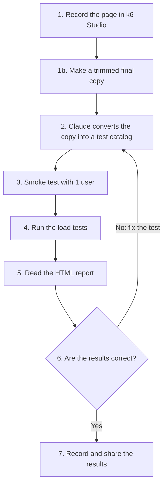

# Load Testing Playbook: k6 Studio + Claude Code

Nov 17, 2026 · @Vishal Chincholi

## What this playbook is

This playbook shows how to find out how fast a web page's API stays when many people use it at once, without writing test code by hand. You click through the page once in your browser, and the tools turn that click-through into a test that repeats it for 10, 50 or more simulated users.

**Who it is for:** QA, developers, and anyone asked to "load test this page". No k6 coding knowledge is needed; you need to be comfortable copying commands into a terminal.

**Use it when:**

- A page feels slow and you want numbers, not opinions.
- A release, data migration or infrastructure change needs a before/after comparison.
- You need to know how many users a page can handle before it slows down.

**What you get at the end of one cycle:**

- A reusable test for each recorded page, kept in the repo and re-runnable any time.
- An HTML report per run: response times, errors, and the slowest requests.
- A short, checked summary you can paste into a ticket, time log or status update.

The template was built and proven on a web dashboard with a REST API backend. Section "Adopting this template in a new project" lists the few things to change for your project.

## How it works



You click through the page once; Claude converts that recording into a test, and k6 replays it for as many users as you choose. Step 6 is the one most often skipped: a green run only means the server answered, not that it answered correctly.

## Words you will see

| Term | Plain meaning |
| --- | --- |
| k6 | The free load-testing tool that sends the requests and measures them. |
| k6 Studio | A desktop app that records what your browser does on a page, so you don't write requests by hand. |
| Recording | The file k6 Studio saves after you click through a page. It contains a live login token and password. |
| Catalog (request lib) | The cleaned-up list of requests made from a recording, plus a CSV of date ranges. One catalog per page. |
| VU (virtual user) | One simulated person. 50 VUs = 50 people using the page at the same time. |
| Burst / page load | All of a page's requests fired together, as when someone opens the page. |
| Step | One filter state you recorded (step 0 = page opened, step 1 = first filter applied, and so on). |
| p95 | 95% of requests were faster than this. A better guide than the average, because it shows what slow users feel. |
| Threshold | A pass/fail rule, for example "p95 under 3 seconds". A breached threshold makes the run fail. |
| Check | A per-request test: status is 2xx, body is not empty, finished in under 3 s. |
| Preflight (OPTIONS) | A small request browsers send before calls to another domain. Recorded and replayed like the real browser. |
| Cache hit | The server answered from memory instead of the database. Cached answers are much faster. |
| Profile / env file | A small file holding the target URL and test login, e.g. `.env.dev` for the dev server. |

## One-time setup on your machine

Install these once; each takes a few minutes. On Windows, run all commands in **Git Bash**, not PowerShell or cmd.

| Tool | Why you need it | Install (Windows) | Check it works |
| --- | --- | --- | --- |
| Git + Git Bash | Runs the bash scripts | git-scm.com installer | `git --version` |
| k6 | Sends the load | `winget install k6 --source winget` ([install guide](https://grafana.com/docs/k6/latest/set-up/install-k6/)) | `k6 version` |
| Grafana k6 Studio | Records the page | Download from Grafana's k6 Studio page | App opens |
| Node.js 18+ | Syntax-checks generated files | `winget install OpenJS.NodeJS.LTS` | `node --version` |
| Python 3.10+ | Runs the converter | python.org installer, tick "Add to PATH" | `python --version` |
| Claude Code | Runs the conversion and checks for you | VS Code extension or CLI | `/k6-recording-to-lib` appears when you type `/` |

On macOS use `brew install k6 node python`; on Ubuntu follow the install guide link above.

**Then, inside the project repo:**

1. Create your env file from the example, once per environment you test:

```bash
cp performance/shared/env/.env.example performance/shared/env/.env.dev
```

2. Edit `.env.dev` and fill in `BASE_URL` (the API address, ending in `/api/v1`), `EMAIL` and `PASSWORD` of a **test** account. This file is gitignored; never commit it.
3. Make the scripts runnable: `chmod +x performance/k6/run.sh`.
4. If a `.sh` file fails with `bad interpreter`, the line endings are wrong. Fix once: `git config --global core.autocrlf input`, then `git checkout -- performance/k6/run.sh`.

## Adopting this template in a new project

This repo is the template. Click **Use this template** (or fork it) on GitHub, or copy the two folders below into your own repo, then adapt three things. Ask a developer to do this part once; everything after it is layman-friendly.

**Try it first (1 minute).** A `sample` catalog is included. It calls the public Grafana QuickPizza demo API, so it runs with no setup beyond the tools above:

```bash
cp performance/shared/env/.env.example performance/shared/env/.env.dev
CATALOG=sample VUS=1 BURSTS=1 bash performance/k6/run.sh page-load-retail dev
```

**1. Copy these folders and files**

```text
.claude/skills/k6-recording-to-lib/      the Claude skill + converter + its tests
performance/
  k6/
    run.sh                                 runs a test with an env profile
    scripts/                               the test types (page-load-retail, load-baseline, load-capacity)
    lib/                                   login, sending, reports, catalog list
      pages/                               generated catalogs go here (requests-sample.js is a demo; delete it)
    k6-studio-raw-scripts/.gitignore       keeps recordings out of git
    reports/.gitignore                     keeps reports out of git
  shared/
    env/.env.example                       template for target URL + test login
    inputs/                                generated date CSVs go here (sample.csv is a demo; delete it)
  README.md                                run reference
```

This repo already contains all of these files with working samples. See `performance/README.md` for the annotated tree.

In `lib/catalogs.js`, delete the `sample` import and entry once you have your own catalog, but keep the two marker comments `// <k6-recording-to-lib:imports>` and `// <k6-recording-to-lib:entries>`. Keep `templateBody` (in `lib/requests-retail.js`), because `send.js` imports it.

**2. Adapt these project-specific points**

| What | Where | Reference value | Change to |
| --- | --- | --- | --- |
| API path prefix | converter flag `--api-prefix` | `/api/v1` | Your API's prefix; requests outside it are dropped |
| Login request | `performance/k6/lib/login.js` | `POST /auth/login` with `{email, password}`, token in `access_token` | Your login endpoint, body fields and token field |
| Auth calls to skip | converter (paths starting `/auth/`) | `/auth/*` | Your auth paths, so recordings don't replay logins |
| Date fields | converter (`date_range.start_date` / `end_date`) | Reference request shape | Your date field names, if they differ |
| Comparison fields | converter (`comparison.type`) | `custom`, `WoW`, `MoM`, `QoQ`, `YoY` | Remove or adapt if your API has none |
| Pass/fail targets | `thresholds` in each `scripts/*.js` | p95 < 3 s, errors < 1% | Your SLOs |

**3. Prove the copy works**

```bash
python -I -B .claude/skills/k6-recording-to-lib/scripts/test_convert.py
```

All tests must pass. After changing the converter, update or add tests in `test_convert.py` the same way, and ask Claude to do it for you: *"Adapt the k6-recording-to-lib converter to our API: prefix /api, login at /session, dates in from/to. Add tests first."*

## Step 1: Record a user journey in k6 Studio

Record one page per recording, doing exactly what a real user does on it. The recording becomes the test, so whatever you click is what 50 users will do.

1. Open k6 Studio and start a new **Recording**. It opens its own browser.
2. Go to the app, log in with the **test** account, and open the page you want to test.
3. Wait until every widget has loaded. This is step 0, the plain page load.
4. Apply filters one at a time, waiting for the page to finish each time. Each filter state becomes a step you can replay on its own.
5. Stop the recording, then use k6 Studio's **Generate script** / export to save it as a `.js` file.
6. Save it into `performance/k6/k6-studio-raw-scripts/` as `<page-name>-original.js`, e.g. `checkout-linked-original.js`. Then make the final copy (Step 1b).

**Do**

- One page per recording, named after the page.
- Keep the journey short: page load plus 1–3 filter changes.
- Use date presets your users actually use. Each distinct date range you pick becomes a row in the test's date CSV.

**Don't**

- Don't record with a personal or admin account; the file stores its password and a live login token.
- Don't save the recording anywhere else, attach it to tickets, or commit it. The raw-scripts folder is gitignored for this reason.
- Don't mix different comparison types for the **same** date range (for example "vs last week" and "vs last month" on one range). The converter rejects it. Different ranges with different comparison types are fine.
- Don't expect a filter you didn't click to be tested. If the page has two modes (e.g. Linked and Independent), record both.

## Step 1b: Make a final copy of the recording

> **Important: never convert the raw recording directly.** Keep the original untouched as your backup, make a copy, remove the calls that are not part of the journey from the copy, and convert only the copy. A stray call in the copy becomes load on the server 50 times over.

**Name the two files**

| File | Purpose | Edit it? |
| --- | --- | --- |
| `k6-studio-raw-scripts/<page-name>-original.js` | Exactly what k6 Studio saved; your backup | Never |
| `k6-studio-raw-scripts/<page-name>.js` | Final copy, trimmed; the one you convert | Yes |

Both stay in the gitignored folder; both contain your credentials.

**Remove from the final copy**

- Requests from pages you opened by mistake, or after you finished the journey.
- Filter clicks you made by accident and then undid.
- Repeated page refreshes, if you only want one page load per step.
- Calls that write data you don't want written on every pass (for example analytics or feedback endpoints), if the team agrees.
- A second comparison type on the same date range (e.g. "vs last week" and "vs last month" on one range); keep one.

**No need to remove** (the converter drops these automatically): login and `/auth/*` calls, the browser's own page loads on the frontend address, third-party calls outside the API, duplicate requests, cookies and browser headers.

**How to remove a call safely.** Each recorded call is one block of four parts: `params = {...};`, `url = http.url`...`;`, `resp = http.request(...);` and usually a `check(resp, ...);` line. Delete the whole block or none of it. A half-deleted block makes the converter stop with an error.

The easiest way is to ask Claude:

```text
Make a final copy of performance/k6/k6-studio-raw-scripts/<page-name>-original.js
as <page-name>.js. Remove every call to /analytics/events and every call made after
the second filter change. Keep the original unchanged and list what you removed.
```

Then run Step 2 on the final copy and check the dry-run report: *recorded → kept* and the *steps* list should show only the journey you meant.

## Step 2: Convert the recording with Claude

Claude turns the recording into a test catalog by running the converter script; nobody edits the generated files by hand. A conversation takes 5–10 minutes and Claude asks you three things.

1. Open Claude Code in the repo (VS Code panel or terminal) and type:

```text
/k6-recording-to-lib
```

2. **Claude lists the recordings it finds and asks which one, and what to name the test.** Pick a short lowercase name with dashes, one per page, e.g. `checkout-linked`. Letters like `&` are not allowed.
3. **Claude does a dry run and shows a report.** Nothing is written yet. Check:
   - *recorded → kept*: duplicates and login calls are dropped on purpose.
   - *steps*: one line per filter state you clicked. Missing a filter you meant to test? Re-record.
   - *Date ranges found*: each becomes a CSV row, with the comparison range it will use.
   - Any line starting `UNRESOLVED` or `WARNING`: ask Claude what it means before going on.
4. **Claude asks whether to add more date ranges.** Reply `none` to keep only the recorded ones, or give extra ranges like `2026-07-01:2026-07-31, 2026-06-01:2026-06-30`. More ranges = more realistic cold-data testing; stay within dates the system has data for.
5. **Claude writes the files and verifies them**: syntax check, a scan for leaked passwords/tokens/dates, and a k6 load check. It may also run one live page load with 1 user.

**What gets created**

| File | What it is | Commit it? |
| --- | --- | --- |
| `performance/k6/lib/pages/requests-<name>.js` | The page's requests, with dates as placeholders | Yes |
| `performance/shared/inputs/<name>.csv` | One row per date range to test | Yes |
| `performance/k6/lib/catalogs.js` | Gets one new line registering `<name>` | Yes |
| Raw recording | Contains credentials | Never |

**If Claude reports a conversion error (exit 2)**, the recording has a shape the converter doesn't know yet. Say *"extend the converter for this, test first"*. Claude adds a failing test, fixes the converter, and re-runs; it never patches the generated file by hand. Examples from real use: mixed WoW/MoM comparisons, a Windows file-encoding bug, and the browser's own page request being recorded.

## Step 3: Smoke test with 1 user

Always run one page load with one user before any real load: it proves login, the target URL and every request work, in about 5 seconds. In Git Bash, from the repo root:

```bash
mkdir -p performance/k6/reports/<name>-smoke
CATALOG=<name> VUS=1 BURSTS=1 REPORTS_DIR=../reports/<name>-smoke \
  bash performance/k6/run.sh page-load-retail dev
```

Replace `<name>` with the catalog name from Step 2, and `dev` with your env profile (the part after `.env.` in the env file name).

**Pass** = every line in the summary shows a green ✓, `checks` is 100%, and `http_req_failed` is 0%. Note the `page_load_wall_duration_ms` value: that is your 1-user baseline, and every later result is compared to it.

**Fail?** Read the first red ✗ line and see Troubleshooting below. Do not move on to load tests until the smoke test passes.

## Step 4: Run the load tests

Pick the test type by the question you are answering, then raise users in steps (1 → 10 → 50) instead of jumping straight to a big number. You can also just ask Claude: *"Run load-baseline for \<name> with 50 VUs for 1 minute on dev, reports in a folder called \<name>-50VU"*.

**Which test type?**

| Question | Test type | What it does |
| --- | --- | --- |
| How fast does the page open when N people open it together? | `page-load-retail` | Each user fires the whole page at once, repeatedly |
| How does it hold up under steady use? | `load-baseline` | Each user walks through all requests one by one, 1 s apart |
| What is the maximum requests per second? | `load-capacity` | Sends a fixed rate of requests regardless of users |

**Settings you can change** (set before the command, on the same line)

| Setting | Used by | Default | Meaning |
| --- | --- | --- | --- |
| `VUS` | page-load, baseline | 1 | Number of simulated users |
| `BURSTS` | page-load | unset | Page loads per user; unset = repeat for `DURATION` |
| `DURATION` | all | 1m / 2m | How long to run (`30s`, `1m`, `5m`) |
| `PEAK_VUS`, `STAGE_DURATION` | baseline | 300, 2m | Ramp profile: ⅓ → peak → ⅓ users over 5 stages |
| `STEP` | page-load | 0 | Which recorded filter state to replay |
| `COLD` | page-load | false | `true` = rotate through all CSV date ranges |
| `RATE` | capacity | 500 | Requests per second |
| `REPORTS_DIR` | all | `../reports` | Where reports go; make the folder first |

The env file wins over the command line for keys it sets (e.g. `SLEEP`). To change those, edit the env file.

**Ready-to-copy commands** (Git Bash, repo root; replace `<name>`)

```bash
# 10 users, 3 page loads each
mkdir -p performance/k6/reports/<name>-10VU
CATALOG=<name> VUS=10 BURSTS=3 REPORTS_DIR=../reports/<name>-10VU \
  bash performance/k6/run.sh page-load-retail dev

# flat 50 users for 1 minute
mkdir -p performance/k6/reports/<name>-50VU-1m
CATALOG=<name> VUS=50 DURATION=1m REPORTS_DIR=../reports/<name>-50VU-1m \
  bash performance/k6/run.sh load-baseline dev

# ramp 17 → 50 → 17 users, 1 minute per stage (5 min total)
CATALOG=<name> PEAK_VUS=50 STAGE_DURATION=1m \
  bash performance/k6/run.sh load-baseline dev
```

Press `Ctrl+C` to stop a run early. Before running more than about 10 users on a **shared** environment, tell the team: it slows the server for everyone.

## Step 5: Read the report

Each run writes three files to its `REPORTS_DIR` folder under `performance/k6/reports/`. Open the `.html` in a browser for the full picture, and the `-slowest.md` for the quick answer.

| File | Use it for |
| --- | --- |
| `<test>-<timestamp>.html` | Full report: every metric, check and threshold |
| `<test>-<timestamp>-slowest.md` | Every request type ranked slowest first |
| `<test>-<timestamp>.json` | Raw numbers, for Claude or a spreadsheet |

The timestamp in the file name is **UTC**, not your local time (India is 5 h 30 min ahead), so the newest file may not look newest. File names follow the test type, not the page, which is why each run gets its own folder.

**The numbers that matter**

| Number | Where | Good looks like |
| --- | --- | --- |
| `http_req_failed` | Summary | 0%. Anything above 1% fails the run |
| `checks` | Summary | 99% or more. Below that, look for which check failed |
| `http_req_duration` p95 | Summary | Under your target (3 s by default) |
| `page_load_wall_duration_ms` | page-load runs | Close to the 1-user baseline |
| Top rows of `-slowest.md` | Slowest file | The requests to investigate first |
| `http_reqs` rate | Summary | Requests per second the server handled |

**How to read a failed run:** if `http_req_failed` is 0% but `checks` failed, the server answered correctly but too slowly (the "duration < 3s" check). Compare each slow request with its 1-user time: a request that is 20× slower under load is the bottleneck. Ask Claude *"summarise this report and the slowest requests"* and give it the folder.

## Step 6: Check the results are correct

A passing run only proves the server answered `2xx` with a non-empty body in time; it does not prove the answers were right. Before reporting numbers, confirm two things: the test sends what the UI sends, and the timings measure the server.

**A. The test matches real use** (ask Claude to do A1–A3)

1. **Requests match the recording.** Ask: *"Compare every request the \<name> catalog sends with the raw recording."* Expect every recorded API request to match exactly. The only intended differences: `query_id` and `occurred_at` removed, and comparisons sent as `custom` with explicit dates.
2. **Responses contain real data.** Ask: *"Run one live pass per date range and check every response has data and the right compare period."* Look for empty results; one is fine only if the page also shows that widget empty.
3. **Cache status.** Check the `cache_hit` / `served_from_cache` flags in responses. All `false` means you measured database speed, not cached speed. Say which in your report.
4. **You compare numbers with the UI.** Open the page with the same filters and dates and check 3–5 headline numbers Claude extracted. Matching numbers = accurate end to end.

**B. The timings are trustworthy**

| Check | How | Red flag |
| --- | --- | --- |
| Your machine isn't the bottleneck | Watch CPU during the run; in the report compare `http_req_blocked` with `http_req_waiting` | CPU near 100%, or blocked time comparable to waiting time |
| Network vs server time | Use the 1-user run as the floor | Light requests already slow at 1 user |
| Server agrees | Compare with server-side timing logs, if the project has them | Server says fast, k6 says slow = queueing before the code |
| Repeatable | Run the same test 2–3 times | p95 differs by more than about 20% |
| Quiet environment | Run when others aren't testing or deploying | Results jump between runs at busy times |
| Counts add up | Passes × requests per pass + 1 login ≈ `http_reqs` | Big mismatch = requests skipped or retried |

## Step 7: Record and share the results

Log every run in one table, then write the summary from it. Copy this run log into your project's tracker or a copy of this doc; the first row is a filled example.

| Date | Page (catalog) | Test type | Users × duration | Env | Errors | Checks | p95 | Page load avg | Slowest request (p95) | Cached? | Report folder |
| --- | --- | --- | --- | --- | --- | --- | --- | --- | --- | --- | --- |
| 2026-10-22 | checkout-linked | load-baseline | 50 × 1 min | dev | 0% | 97.97% | 13.5 s | — | filters all, 18.0 s | No | checkout-linked-50VU-1m-baseline |
|  |  |  |  |  |  |  |  |  |  |  |  |

**Results summary template** (ask Claude: *"write the results summary for these runs using the playbook template"*)

```markdown
**Load test: <page> on <env>, <date>**
Result: <pass / fail against target p95 <X> s>, <N>% errors.
- 1 user: page load <x> s (baseline)
- <N> users: p95 <x> s, page load <x> s (<k>× baseline)
- Bottleneck: <request>, <1-user time> → <load time>
- Data checked: requests match recording, responses match UI, cache <on/off>
Next: <what to fix or retest>. Reports: performance/k6/reports/<folder>
```

**Time-log comment template**

```markdown
k6 Studio load testing — <page(s)> (<date>)
- Recorded <page> in k6 Studio; converted to catalog <name> (<n> requests, <n> steps, <n> date ranges)
- Converter changes (if any): <what>, tests passing
- Runs on <env>: 1 user (<result>), <N> users (<result>)
- Findings: <bottleneck + numbers>
- Validation: requests match recording; responses checked; UI numbers <matched/pending>
- Pending: <next steps>
```

## Safety rules

Load tests send real traffic and recordings hold real credentials, so these rules are not optional.

1. **Never commit a raw recording or an env file.** Both hold a password; recordings also hold a live login token. Never use `git add -f` on them.
2. **Use a dedicated test account**, never a personal or admin login.
3. **Never load test production** without written approval and an agreed time window.
4. **Warn the team before more than about 10 users on a shared environment.** In real use, 50 users made one dev endpoint 27× slower for everyone.
5. **Know the side effects.** Requests that write data run on every pass. For example, a `/usage/events` endpoint writes usage-log rows each time; list your project's equivalents before the first run.
6. **Commit only generated files**: `requests-<name>.js`, `<name>.csv`, and the `catalogs.js` line. Claude's verify step scans them for tokens and passwords; re-run it if you are unsure.
7. **Delete stray copies** of recordings left in Downloads or k6 Studio's own folder once they are in the raw-scripts folder.

## Troubleshooting

Every row below happened in real use. When in doubt, paste the error to Claude and ask what it means.

| You see | Cause | Fix |
| --- | --- | --- |
| `Recording mixes comparison types` / `Window ... recorded with comparison types` | One date range recorded with two comparison types | Re-record using one comparison per date range |
| `Dates outside date_range would stay hardcoded` | A date sits somewhere the converter can't turn into a placeholder | Ask Claude to extend the converter (test first) |
| `moduleSpecifier ... couldn't be found` when starting a run | A catalog's files were deleted but it is still listed in `catalogs.js` | Ask Claude to unregister that catalog, or regenerate it |
| `Invalid UTF-8 character` from k6 | Generated file saved in the wrong encoding (old converter on Windows) | Update the converter and re-generate with `--force` |
| `bad interpreter` | Windows line endings in `.sh` files | `git config --global core.autocrlf input`, then `git checkout -- performance/k6/run.sh` |
| `env file not found` | No `.env.<profile>` for the profile you named | Copy `.env.example` to `.env.<profile>` and fill it |
| `Login failed (status=401 ...)` | Wrong test credentials in the env file | Fix `EMAIL` / `PASSWORD` |
| Every request `401`, login passed | Token not reaching the requests (custom script) | Use `lib/login.js` + `lib/send.js` as the scenarios do |
| `CATALOG='x' has no entries for STEP=n` | That step doesn't exist in the recording | Check the steps list in the dry-run report |
| `VAR=value: command not found` | Command run in PowerShell or cmd | Use Git Bash |
| Can't find the newest report | File name timestamp is UTC | Sort by modified time, or use `REPORTS_DIR` per run |
| Setting on the command line ignored | The env file sets the same key and wins | Edit the env file, or run `k6 run -e KEY=value` directly |

## Checklist for each test cycle

Copy this list for each page you test and tick as you go.

**Before**

- [ ] Tools installed and env file filled with a test account
- [ ] Team told about the planned runs and environment
- [ ] Side effects (data-writing requests) known

**Record and convert**

- [ ] Page recorded in k6 Studio, saved as `<page-name>-original.js`; final copy `<page-name>.js` made with extra calls removed
- [ ] `/k6-recording-to-lib` run; dry-run report reviewed (steps, date ranges, no `UNRESOLVED`)
- [ ] Extra date ranges decided
- [ ] Files written; verify step passed

**Run**

- [ ] Smoke test, 1 user: all checks pass, baseline noted
- [ ] 10 users
- [ ] Target users (e.g. 50), each run in its own report folder

**Check and report**

- [ ] Requests match the recording; responses contain real data
- [ ] Cache status noted
- [ ] Headline numbers matched against the UI
- [ ] Run log filled; summary and time-log comment written
- [ ] Generated files committed; raw recording and env file not committed
